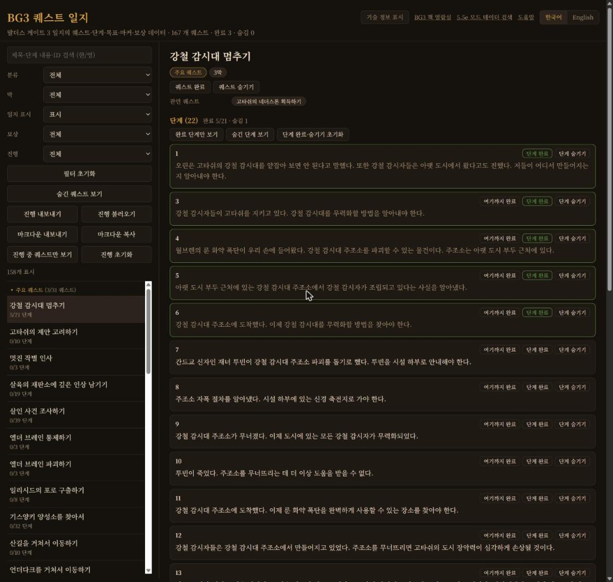
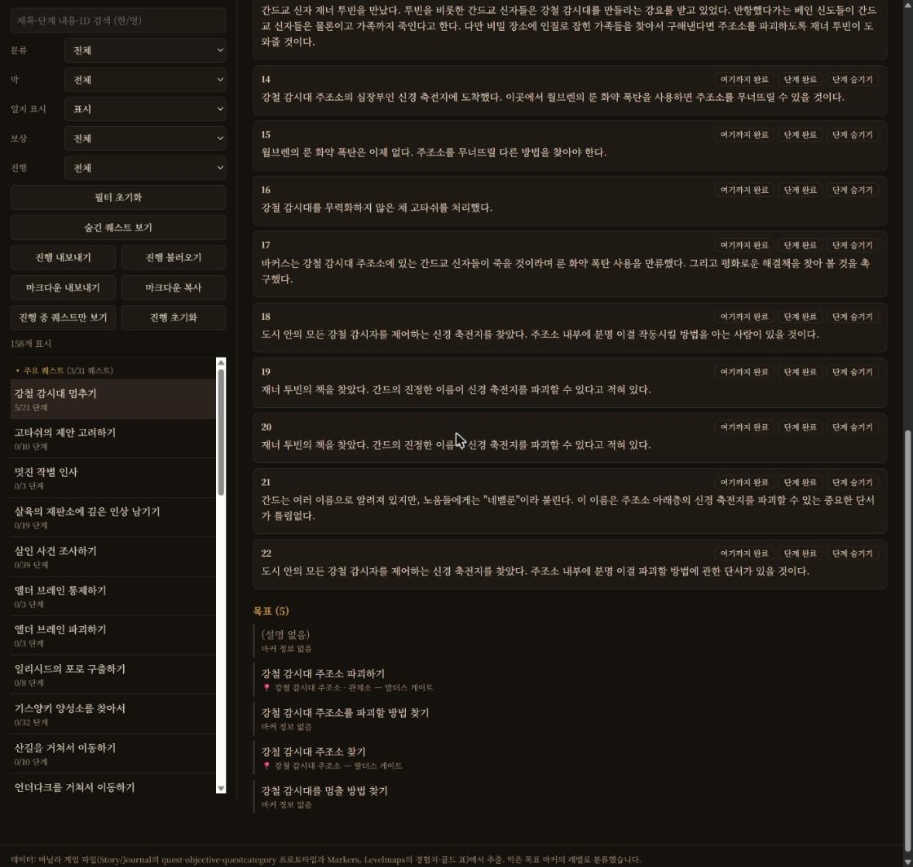

# BG3 퀘스트 일지

[English](README.md)

발더스 게이트 3 바닐라 데이터의 일지 퀘스트를 단계·목표·지도 마커·보상까지 조회하고, 내 플레이 진행을 기록하는 사이트입니다.

- 사이트: https://yoonmoonsik.github.io/bg3quest/

## 조회

- 분류(주요 퀘스트, 개인 퀘스트, 서막, 각 지역, 동료)별로 묶어 보여 줍니다. 분류는 고정 순서, 분류 안 퀘스트는 게임의 SortingPriority 순서입니다.
- 제목·단계 내용·ID를 한국어나 영어로 검색합니다.
- 분류, 막, 일지 표시, 보상 종류, 진행으로 거릅니다.
- 퀘스트마다 단계, 목표와 지도 마커·지역, 보상, 관련 퀘스트(상위·하위 퀘스트)를 보여 줍니다.
- 기술 정보(ID, GUID, 개발 메모, 경험치, 마커 대상)는 켜기 전까지 숨겨 둡니다.
- 한국어·영어 화면을 지원합니다.

## 진행 기록

- 퀘스트를 **완료**나 **숨김**으로, 단계마다 완료나 숨김으로 표시합니다. 분기 때문에 진행할 수 없는 퀘스트와 단계는 숨깁니다.
- 진행 수: 목록의 "5/21 단계", 분류와 막의 "3/31 퀘스트", 상단의 전체 완료·숨김 수. 숨긴 퀘스트와 단계는 분모에서 뺍니다.
- **여기까지 완료**는 1단계부터 그 단계까지 숨기지 않은 단계를 모두 완료합니다.
- 진행 중 퀘스트만 보기(단계를 하나 이상 완료했고 퀘스트는 아직 완료·숨김이 아닌 것), 완료 단계만 보기, 숨긴 단계·숨긴 퀘스트 보기·숨기기, 퀘스트별 단계 표시 초기화.
- Ctrl+Z로 마지막 진행 변경을 되돌립니다.
- 진행을 JSON으로 내보내고 불러옵니다. 불러오기로 바뀐 진행은 복원할 수 있습니다.
- 마크다운 내보내기·복사: 숨기지 않은 퀘스트의 완료 표시와 완료한 단계만 옮깁니다.
- 기록은 브라우저 `localStorage`에만 저장됩니다.

## 키보드 단축키

| 키 | 동작 |
|---|---|
| T | 기술 정보 표시·숨김 |
| C | 보고 있는 퀘스트 완료 |
| H | 보고 있는 퀘스트 숨기기 |
| J / K | 목록의 다음 / 이전 퀘스트 |
| Ctrl+Z | 마지막 진행 변경 되돌리기 |

## 데이터

`build_quests.py`가 언팩한 게임 데이터(`Story/Journal`의 quest·objective·questcategory 프로토타입과 Markers, `Levelmaps`의 경험치·골드 표)에서 `docs/data/quests.json`을 다시 만듭니다. 번역은 `../bg3dnd/.reference`, 지역 이름은 `../bg3dnd/.docs/data/regions.json`을 씁니다.
