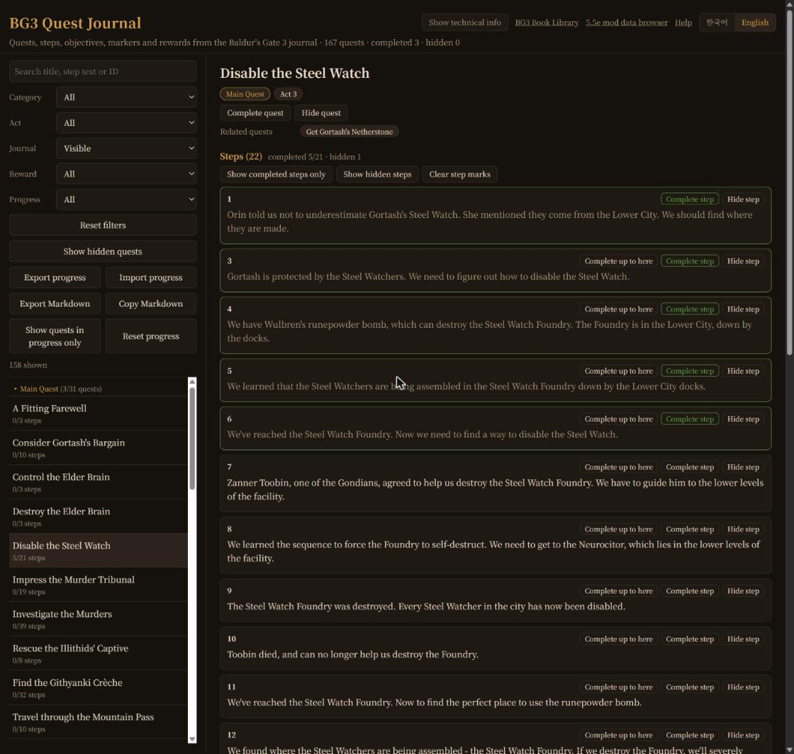
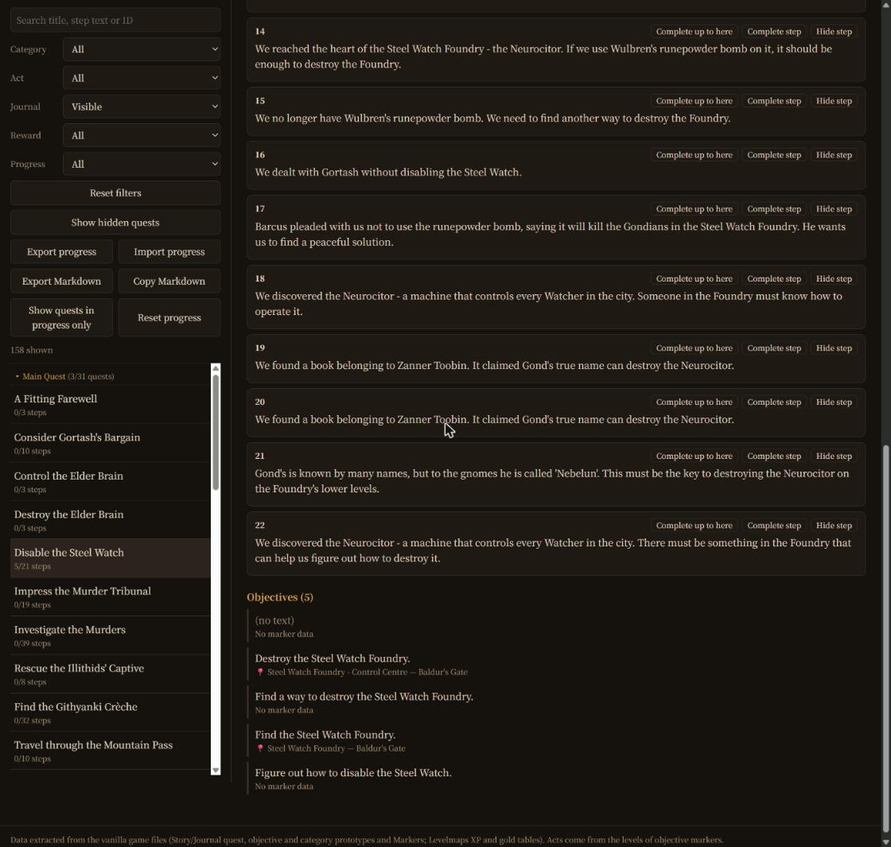

# BG3 Quest Journal

[한국어](README.ko.md)

A website for browsing every journal quest in vanilla Baldur's Gate 3, down to its steps, objectives, map markers and rewards, and for tracking your own playthrough.

- Site: https://yoonmoonsik.github.io/bg3quest/

## Browse

- Quests grouped by category (Main Quest, Personal Quests, Prologue, the act regions, Companions), in a fixed category order and by the game's SortingPriority within a category.
- Search titles, step text and IDs in Korean or English.
- Filter by category, act, journal visibility, reward type and progress.
- Each quest shows its steps, objectives with map markers and regions, rewards, and related quests (parent and subquests).
- Technical info (IDs, GUIDs, dev comments, experience, marker targets) stays hidden until you turn it on.
- Korean and English interface.

## Track your progress

- Mark a quest **completed** or **hidden**, and mark each step completed or hidden. Hide quests and steps your playthrough's branch can never reach.
- Progress counts: "5/21 steps" in the list, "3/31 quests" on each category and act, and completed/hidden totals in the header. Hidden quests and steps are left out of the totals.
- **Complete up to here** completes every step up to that one, skipping hidden steps.
- Show quests in progress only (at least one completed step, quest not yet completed or hidden), show completed steps only, show or hide hidden steps and hidden quests, and clear one quest's step marks.
- Ctrl+Z undoes the last progress change.
- Export and import progress as JSON; the progress an import replaces can be restored.
- Export or copy Markdown: completed quests and completed steps, without hidden quests.
- Progress is saved only in your browser (`localStorage`).

## Keyboard shortcuts

| Key | Action |
|---|---|
| T | Show / hide technical info |
| C | Complete the current quest |
| H | Hide the current quest |
| J / K | Next / previous quest in the list |
| Ctrl+Z | Undo the last progress change |

## Data

`build_quests.py` rebuilds `docs/data/quests.json` from the unpacked game data: the quest, objective and quest category prototypes and Markers in `Story/Journal`, and the experience and gold tables in `Levelmaps`. Translations come from `../bg3dnd/.reference` and region names from `../bg3dnd/.docs/data/regions.json`.
